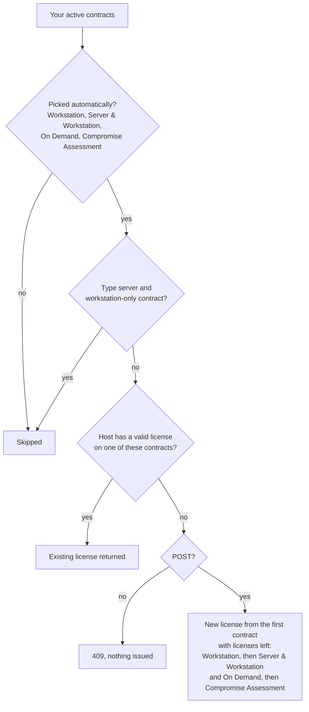

# 2. Generate a license for a host

One request gets the license of a host. If the host already has a valid license, the portal returns it and issues nothing. Otherwise the portal issues a new one from a suitable contract. Ask the same way every time: the portal only looks for existing licenses on the contracts that fit your request ([details](#which-contract-does-the-portal-choose)).

```
POST https://portal.nextron-systems.com/api/public/contracts/issue/{contracts}/{type}/{hostname}
```

For example, a server license for web01, with the portal choosing the contract:

```
https://portal.nextron-systems.com/api/public/contracts/issue/0/server/web01?download=1
                                                              │ │      │    │
                                                              │ │      │    └── answer with the license file (without it: JSON)
                                                              │ │      └─────── hostname: the host that gets the license
                                                              │ └────────────── license type: server or workstation
                                                              └──────────────── contract: 0 = let the portal choose
```

It works with a THOR download token and with a personal API key ([Credentials](01-credentials.md)).

## The request

| Part | Example | Meaning |
|---|---|---|
| `{contracts}` | `0` | Let the portal choose the contract. Recommended. |
| | `1234` | Use contract #1234 only. |
| | `1234,1240` | Let the portal choose among these contracts. |
| `{type}` | `server` | A license that is valid on any system: servers and workstations, Windows, Linux and macOS. |
| | `workstation` | A license for a Windows workstation or a Mac. Uses THOR Workstation contracts first. |
| `{hostname}` | `web01` or `web01.corp.example.com` | The host. Letters, digits, `.`, `-` and `_`. |
| `?download=1` | optional | Answer with the license file instead of JSON. |
| `?comment=...` | optional | Comment stored with a newly issued license, up to 1000 characters on one line. Default: *automatically issued*. |

`client` is another name for `workstation`. Other query parameters have no effect, and the portal rejects names it does not know at all with `400 validation failed, unknownQueryParam`.

Contract numbers are the numbers the portal shows as *Contract #1234*. With a download token for one contract, `0` means that contract.

### GET or POST?

- `POST` returns the existing license of the host, or issues a new one.
- `GET` only returns an existing license. If the host has none, the answer is `409` and nothing is issued.

Use `GET` to check whether a host is licensed without spending a license.

## The answer

With `?download=1`, the answer is the license file. Save it as it is.

Without it, the answer is JSON that describes the license. The license file is in `blob`, base64-encoded:

```json
{
  "id": "5b0e8f8a-3c1d-4a51-9f53-2e7c6f0b9d14",
  "hostname": "sqQFAQE1raHO0y8OISn5jL9nqn8",
  "contract_id": "8d3f2a6e-7b41-4c0a-a2e5-1f9c4b7d6e20",
  "contract_number": 1234,
  "starts_on_time": "2026-10-26T15:27:00Z",
  "expires_on_time": "2027-10-26T00:00:00Z",
  "description": "automatically issued",
  "blob": "TElDRU5TRS1EQVRB..."
}
```

| Field | Meaning |
|---|---|
| `id` | License ID, used by the [full API](04-find-download-count.md) |
| `hostname` | The hostname hash. The portal never stores the plain hostname. |
| `contract_number`, `contract_id` | The contract the license came from |
| `starts_on_time`, `expires_on_time` | Validity in UTC |
| `description` | The comment |
| `blob` | The license file, base64-encoded |

The answer does not say whether the license is new or existed before. To know, send `GET` first and `POST` only when `GET` answers `409`, like the scripts do.

### Errors

Errors come back as plain text, not JSON: `ERROR: <reason>`.

| Status | Message | What it means |
|---|---|---|
| 400 | `validation failed, ...` | A part of the URL or a query parameter is invalid, for example a hostname with characters other than letters, digits, `.`, `-` and `_`. The message names the part. |
| 400 | `mismatch between token and selected contract` | Your download token belongs to a different contract than the one in the URL. Use `0`. |
| 401 | `missing authorization header or token` | No credential was sent. |
| 401 | `invalid token` | The portal does not accept the credential. Check for a `Bearer` prefix, spaces or line breaks. A disabled company account gets this answer too. |
| 404 | `error getting contract, contractNumber: 1234` | There is no contract with this number in your account. |
| 409 | `no contract found that holds a license for this hostname` | `GET` only: the host has no license yet. |
| 409 | `no contract found that could be used to issue a license for this hostname` | `POST`: no contract can issue this license. See below. |
| 503 | `Our web portal is ... unavailable due to maintenance ...` (no `ERROR:` prefix) | Maintenance, or the portal cannot reach its backend. Try again in a minute. |

When no contract can issue the license, check:

- Are the contracts used up? A contract issues as many licenses as it holds.
- Are they active? Expired, suspended and not-yet-started contracts are skipped.
- Do you ask for `server` with only THOR Workstation contracts? Ask for `workstation`.
- Does the contract allow only a few hosts? A THOR Forensic Lab contract, for example, is bound to one host.
- With `0` and an API key, the portal does not consider THOR Forensic Lab, THOR Thunderstorm and THOR Silent contracts. Pass their contract number.

## Which contract does the portal choose?

With `0` and an API key, the portal:

1. takes your active contracts that it may pick on its own: THOR Workstation, THOR Server & Workstation, THOR On Demand and THOR Compromise Assessment,
2. drops the THOR Workstation contracts when you ask for `server`,
3. returns the existing license of the host if one of these contracts has a valid one,
4. otherwise issues the license from the first contract with licenses left, in this order: THOR Workstation, then THOR Server & Workstation and THOR On Demand, then THOR Compromise Assessment.



When you name contracts:

- **One number:** the portal uses exactly that contract, if it is active and fits the type. This also works for THOR Forensic Lab, Thunderstorm and Silent contracts.
- **Several numbers:** the portal chooses among them as above. THOR Forensic Lab, Thunderstorm and Silent contracts may be part of the list.

An existing license on a contract the portal does not consider is not returned. If a host has a license from a THOR Workstation contract and you ask for `server`, or a license from a Forensic Lab contract and you ask with `0`, the portal issues a second license from another contract. Ask the same way every time.

## Server or workstation?

- **You only have THOR Server & Workstation contracts** (the most common case): it does not matter. Use `server`.
- **You also have THOR Workstation contracts:** ask for `workstation` for Windows workstations and Macs, so these licenses are used first, and `server` for everything else.
- **You only have THOR Workstation contracts:** always ask for `workstation`.

Workstation licenses do not work on Windows Server or on Linux, including Linux desktops.

The scripts can detect the type of the computer they run on: `--type auto` and `-Type Auto`.

## Hostnames

- The portal licenses the short name: everything before the first dot, in lower case. `WEB01`, `web01.corp.example.com` and `web01` share one license.
- Use the name that the `hostname` command prints on the host.
- The portal stores only a hash of the hostname, which is what the portal and its answers show. [Searching](04-find-download-count.md) by plain hostname still works. To see hostnames in the portal, put them in the comment.
- A hostname of exactly 27 characters without a dot, such as `workstation-finance-dept-01`, looks like a hostname hash to the portal, and it takes it for one. Add a dot at the end (`workstation-finance-dept-01.`) and the portal treats it as a hostname again. The scripts do this for you.

## Code

### curl

```bash
host=web01
status=$(curl -sS -X POST -H "Authorization: $NEXTRON_PORTAL_KEY" -o "$host.lic" -w '%{http_code}' \
  "https://portal.nextron-systems.com/api/public/contracts/issue/0/server/$host?download=1")
if [ "$status" != 200 ]; then
  echo "HTTP $status: $(cat "$host.lic")" >&2
  rm -f "$host.lic"
fi
```

### PowerShell

```powershell
# Windows PowerShell 5.1 only: [Net.ServicePointManager]::SecurityProtocol = 'Tls12'
$hostname = 'web01'
$uri = "https://portal.nextron-systems.com/api/public/contracts/issue/0/server/$hostname"
try {
    $license = Invoke-RestMethod -Method Post -Uri $uri -Headers @{ Authorization = $env:NEXTRON_PORTAL_KEY }
    [IO.File]::WriteAllBytes((Join-Path $PWD "$hostname.lic"), [Convert]::FromBase64String($license.blob))
    "License for $hostname from contract #$($license.contract_number), valid until $($license.expires_on_time)"
} catch {
    "HTTP $([int]$_.Exception.Response.StatusCode): $($_.ErrorDetails.Message)"
}
```

### Python

Uses [requests](https://pypi.org/project/requests/) (`pip install requests`):

```python
import base64
import os

import requests

hostname = "web01"
answer = requests.post(
    f"https://portal.nextron-systems.com/api/public/contracts/issue/0/server/{hostname}",
    headers={"Authorization": os.environ["NEXTRON_PORTAL_KEY"]},
    timeout=60,
)
if answer.ok:
    lic = answer.json()
    with open(f"{hostname}.lic", "wb") as f:
        f.write(base64.b64decode(lic["blob"]))
    print(f"License for {hostname} from contract #{lic['contract_number']}, valid until {lic['expires_on_time'][:10]}")
else:
    print(f"HTTP {answer.status_code}: {answer.text}")
```

### Check without issuing

Replace `POST` by `GET`. A `409` answer means the host has no license yet:

```bash
curl -sS -o /dev/null -w '%{http_code}\n' -H "Authorization: $NEXTRON_PORTAL_KEY" \
  https://portal.nextron-systems.com/api/public/contracts/issue/0/server/web01
```

### The complete scripts

[`get_license.py`](../scripts/python/get_license.py) and [`Get-NextronLicense.ps1`](../scripts/powershell/Get-NextronLicense.ps1) build on this request. They take one or many hostnames, choose the license type, report whether each license is new, explain errors and retry when the portal is busy. See [scripts/README.md](../scripts/README.md).

## Use the license

Copy the `.lic` file into the THOR program folder on the host. THOR looks for license files there.

Next: [Issue many licenses](03-issue-many-licenses.md)
