# How to Integrate THOR Cloud into Sekoia

The Nextron THOR Cloud integration lets Sekoia collect the scan results from your THOR Cloud or THOR Cloud Lite account. A connector running in Sekoia polls the THOR Cloud API at a regular interval, so you don't need to configure anything in THOR Cloud apart from an API key. Every finished scan is collected once, normalized to Sekoia's event taxonomy, and made available in the Events page, in detection rules and in investigations. This guide covers setup, every setting, and what to do once the events arrive.

The integration is for customers of both Sekoia and Nextron THOR Cloud or THOR Cloud Lite.

## 1. Before you start

You need:

- **A THOR Cloud account API key** with the permissions listed below. See [Create the API key](#11-create-the-api-key).
- **To know which product you use.** THOR Cloud and THOR Cloud Lite are separate services with separate API endpoints. The connector needs to know which one to call.

  | Product | API endpoint |
  |---|---|
  | THOR Cloud | `https://thorcloud.nextron-services.com` |
  | THOR Cloud Lite | `https://thorcloud-lite.nextron-systems.com` |

- **A Sekoia account** with permission to manage integrations and intakes in the community that should receive the events.

### 1.1 Create the API key

Use an **account API key**. It's a machine identity of your THOR Cloud account: it isn't tied to a person, it can be created without an expiration date, and it only gets the permissions you give it. A personal API key (**Settings → API Keys**) also works, but it has all the rights of your user and expires after at most three months.

1. Log in to THOR Cloud or THOR Cloud Lite and open **Settings → Account API Keys**.
2. Click **+ Create**.
3. Fill in the form:

   | Field | What to enter |
   |---|---|
   | **Name** | A name that tells you where the key is used, for example *Sekoia Integration*. |
   | **Expires** | Leave it empty for a key that never expires, or set a date if your policy requires one (see the note below). |
   | **Allow CIDRs** | Leave it empty. If you fill it in, the key only works from these addresses, and the connector runs on Sekoia's infrastructure, not in your network. |
   | **Deny CIDRs** | Leave it empty. |
   | **Roles** | Leave it empty. Give the key only the permissions below. |

   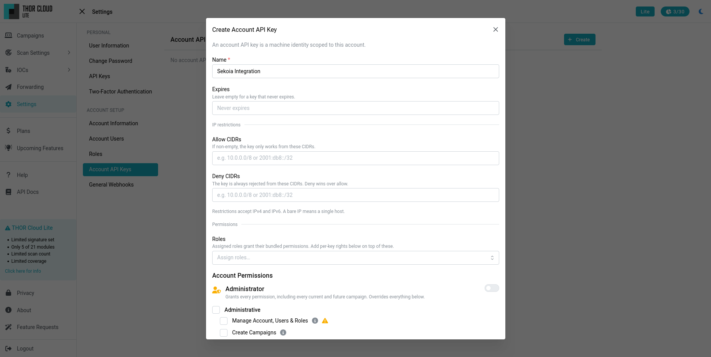

4. Leave **Administrator** unchecked. Collecting scans only needs two permissions, and nothing under **Administrative**: **List Scans** to find the scans, and **Read Logs** to download their logs. If you also want to use the [launcher action](#8-generating-a-thor-cloud-launcher-optional), see the permissions listed there. Choose where to grant them:

   - **All campaigns:** under **Access to all campaigns**, check **List Scans** and **Read Logs**. Sekoia then collects scans from every campaign, including campaigns created later.

     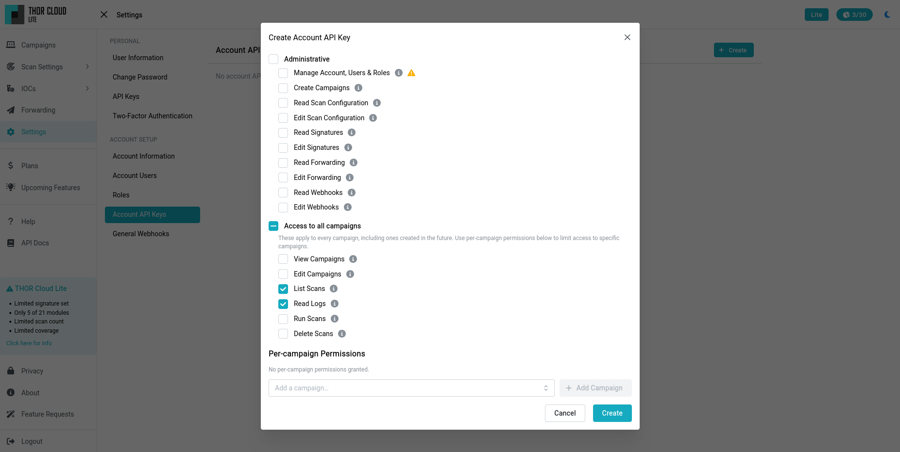

   - **Specific campaigns:** leave **Access to all campaigns** unchecked. Under **Per-campaign Permissions**, select the campaign in **Add a campaign…**, click **+ Add Campaign** and check **List Scans** and **Read Logs** in its row. Repeat for every campaign Sekoia should collect, and enter the same campaign UUIDs in the connector's **Campaigns** setting (see [Connector configuration](#3-connector-configuration)). Campaigns created later aren't included until you add them to the key.

     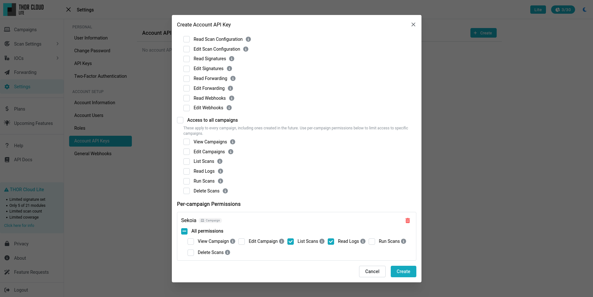

   Don't check **All permissions** for a campaign: it also grants **Edit Campaign** and **Delete Scans**, which the integration doesn't need.

5. Click **Create** and copy the key. You need it in [step 2.1](#21-install-the-integration-and-connect-your-account).

> **If the key expires,** the connector can no longer collect scans and the **Connector logs** show authentication errors. Before the expiration date, create a new key and enter it in the Sekoia account (**Configure → Integrations → THOR Cloud → Show accounts**). Every intake and playbook that uses the account picks up the new key.

## 2. Set it up

Setup has two parts: an **account** that holds your THOR Cloud API key, and an **intake** that receives the events and runs the connector.

### 2.1 Install the integration and connect your account

1. In Sekoia, open **Configure → Integrations** and search for **THOR Cloud**.

   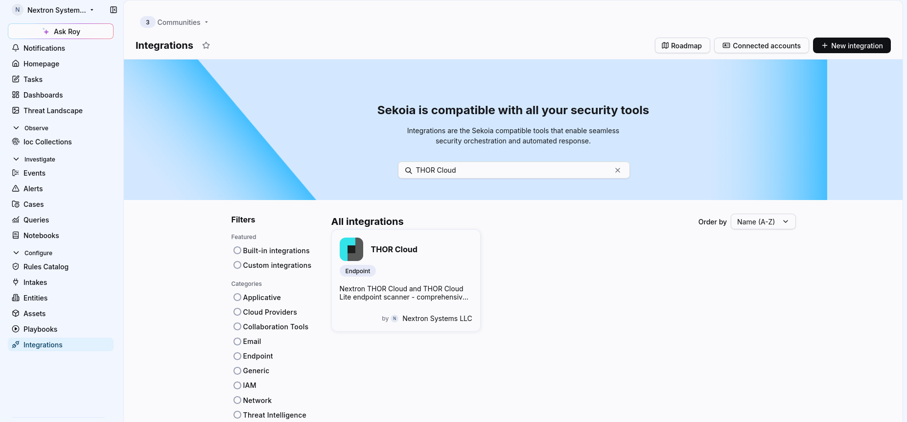

2. Open the **THOR Cloud** integration and click **Connect an account to start**. If the integration already has an account, click **Show accounts**, then **+ Connect an account**.

   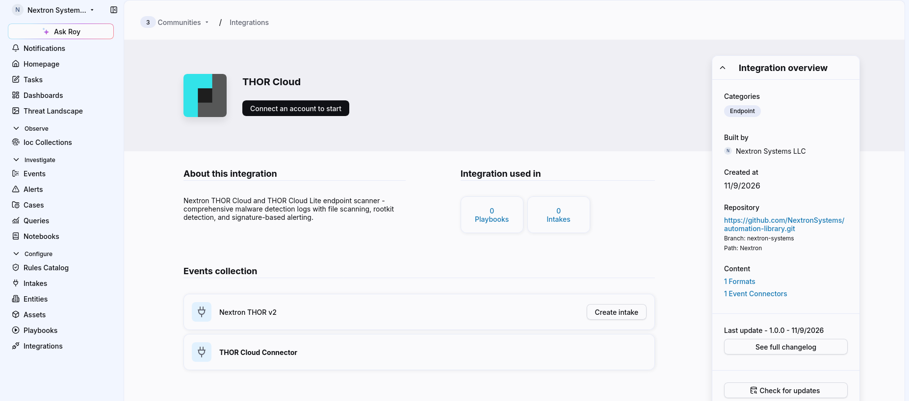

3. Give the account a name, for example *THOR Cloud*, and paste your THOR Cloud API key into **Api Key**. Click **Save**.

   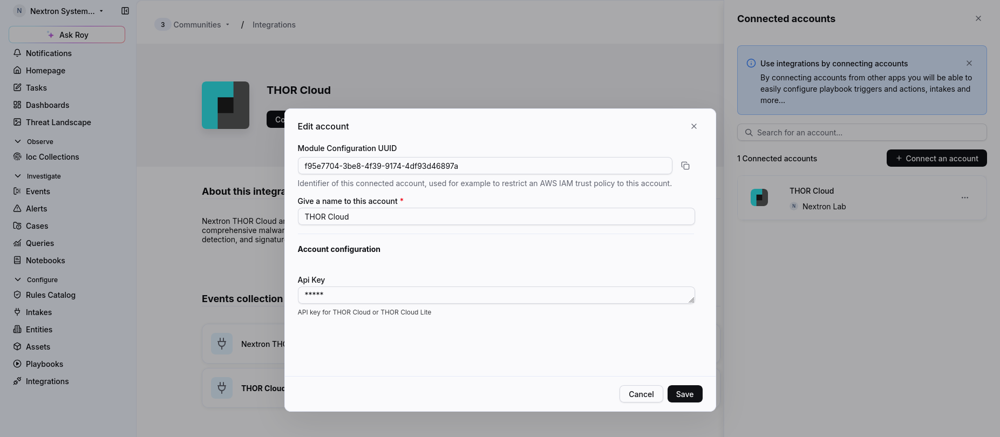

Sekoia checks the key when you save the account: it's accepted if THOR Cloud or THOR Cloud Lite accepts it. The API key is hidden once you save the account. One account can be used by several intakes and playbooks.

### 2.2 Create the intake

1. On the THOR Cloud integration page, under **Events collection**, click **Create intake** next to **Nextron THOR v2**.
2. In **Configure your intake**, give the intake a name, for example *THOR Cloud*, choose the **Community** and the **Entity** the events belong to, and click **Next**.

   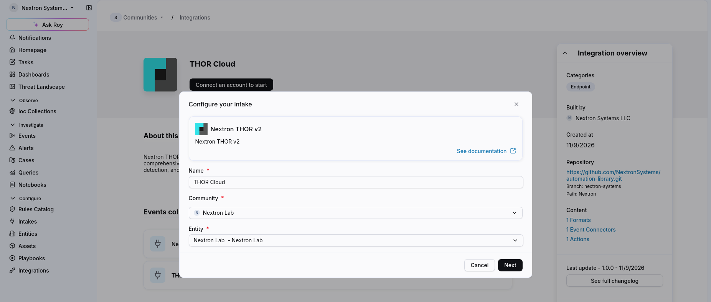

3. In the connector configuration, select the account from step 2.1 and set the options (see [Connector configuration](#3-connector-configuration)). Make sure **Product** matches your service: the default is `thor_cloud_lite`.

   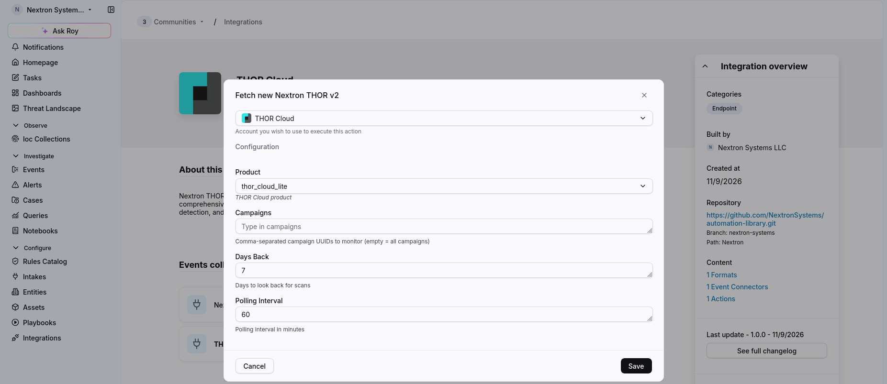

4. Click **Save** and make sure the intake is switched **On**.

The connector starts right away. On its first run it collects every finished scan within the **Days Back** window, so the first batch can be large.

## 3. Connector configuration

| Setting | Default | What it does |
|---|---|---|
| **Account** | – | The account that holds your THOR Cloud API key (see [step 2.1](#21-install-the-integration-and-connect-your-account)). |
| **Product** | `thor_cloud_lite` | Which service to collect from: `thor_cloud` for THOR Cloud, `thor_cloud_lite` for THOR Cloud Lite. A wrong value makes every request fail, because the API key isn't valid for the other service. |
| **Campaigns** | empty | Comma-separated campaign UUIDs, for example `3f1c…, 9a2b…`. Only scans from these campaigns are collected. Leave it empty to collect scans from all campaigns. |
| **Days Back** | `7` | How many days back the connector looks for scans. Only scans created in this window are collected. See [Choosing Days Back](#41-choosing-days-back). |
| **Polling Interval** | `60` | Minutes between two polls. A finished scan arrives in Sekoia at most one interval after it ends. |

You can change these settings at any time. The connector uses the new values on its next poll.

## 4. What the connector does

On every poll the connector:

1. Lists the scans created within the **Days Back** window, newest first, for the selected campaigns or for all of them.
2. Skips scans it has already forwarded. It stores the IDs of forwarded scans, so each scan is sent **only once**, also across restarts.
3. Waits for scans that are still running. They are checked again on the next poll.
4. Downloads the JSON log (`thor.json`) of every finished scan. Scans with the status *successful* and *failed* both count as finished, so you also get the partial results of a scan that failed.
5. Sends every log line as a separate event to the intake, one scan at a time.
6. Marks each scan as forwarded once all of its events were accepted, then waits for the polling interval.

A finished scan without a JSON log has nothing to forward. The connector marks it as done and doesn't check it again. The same applies to scans whose logs are **encrypted** (when the campaign encrypts THOR logs with your account's public key): they can't be parsed, so the connector skips them and logs a warning.

If THOR Cloud can't be reached, the connector logs the error and retries a minute later. If the log of a single scan can't be downloaded, or the intake doesn't accept all of its events, that scan isn't marked as forwarded and the next poll sends it again.

**Everything in the scan log is forwarded,** not only findings. A THOR scan produces many `Info` and `Notice` lines (startup, modules, scanned elements) next to its `Warning` and `Alert` lines. A single scan can produce thousands of events. Use **Campaigns** to limit collection to the campaigns you need.

### 4.1 Choosing Days Back

**Days Back** controls how far back the connector looks for scans.

- **For a backfill,** set a large value before the first run, for example `365`, to bring in your scan history. You can change it at any time.
- **Raising it later is safe.** Scans that were already inside an earlier window aren't sent again. Only older scans, which no window has covered yet, are collected. This lets you extend a backfill step by step.
- **Lowering it doesn't delete anything.** Scans that drop out of the smaller window stay in Sekoia, and aren't sent again if you raise the value later.
- **Keep it longer than your longest scans.** A scan is selected by its creation date. A scan that runs for longer than **Days Back** drops out of the window before it finishes, and its results are never collected.

## 5. Checking the results

Open the intake in **Configure → Intakes**.

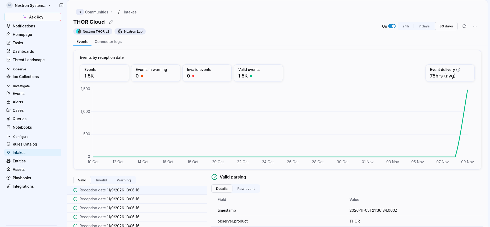

- The **Events** tab shows how many events arrived and whether they were parsed. All events should be **valid**. Click an event to see the parsed fields and the raw THOR log line.
- **Event delivery** is the delay between the event time and its arrival in Sekoia. The event time is the moment THOR wrote the log line on the endpoint, and logs are only collected after the scan finishes. A delivery time of tens of minutes, or longer for a backfill, is therefore expected.
- The **Connector logs** tab shows what the connector does. On every poll you should see:

  | Message | Meaning |
  |---|---|
  | `Fetching scans from <endpoint>` | A poll started. Check that the endpoint matches your product. |
  | `Found N scans (M new to forward)` | `N` scans are in the window, `M` of them haven't been forwarded yet. Running scans are counted as new until they finish. |
  | `N events collected from scan <id>` | `N` log lines of one scan were sent to the intake. |
  | `Scan <id> has encrypted logs, …` | The scan's logs are encrypted and can't be forwarded. |
  | `Only X of N events of scan <id> were accepted …` | Delivery to the intake failed. The scan is sent again on the next poll. |

  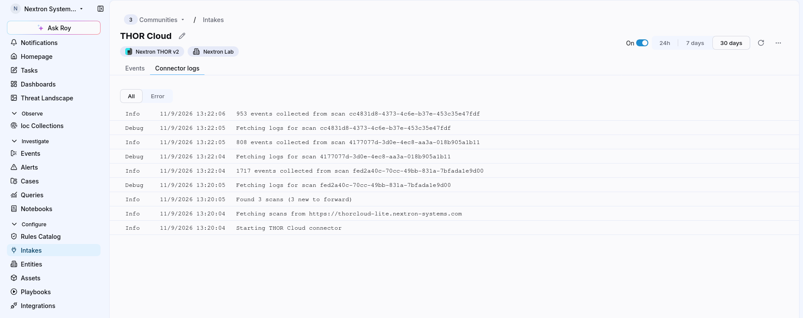

To see the events, open **Investigate → Events** and search for the intake, or filter on `observer.product:THOR`.

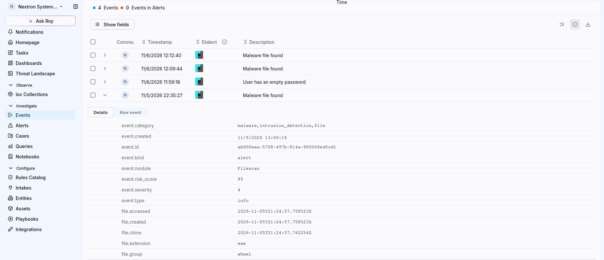

## 6. The normalized events

The intake uses the **Nextron THOR v2** format. It parses THOR's JSON log format version 2.x and maps it to Sekoia's [event taxonomy](https://docs.sekoia.io/integration/develop_integration/formats/taxonomy/), which is based on the Elastic Common Schema (ECS). Every event carries these common fields:

| Field | Content |
|---|---|
| `@timestamp` | When THOR wrote the log line. |
| `host.name` | The scanned endpoint. |
| `observer.vendor` / `observer.product` | `Nextron Systems` / `THOR`. |
| `event.module` | The THOR module that wrote the line, for example `Filescan`, `ProcessCheck` or `Eventlog`. |
| `log.level` | THOR's level: `Debug`, `Info`, `Notice`, `Warning`, `Error` or `Alert`. |
| `event.severity` | `1` for Debug and Info, `2` for Notice, `3` for Warning and Error, `4` for Alert. |
| `event.kind` | `alert` for lines with the level `Alert`. |
| `event.risk_score` | THOR's score for the finding. |
| `event.category` / `event.type` | Derived from the module, for example `file` for Filescan or `process` for ProcessCheck. Alerts also get `intrusion_detection`, malware findings get `malware`. |
| `message` / `event.reason` | THOR's message and the reason for the finding. |
| `nextron.thor.scan_id` | The ID of the THOR scan. Use it to group all events of one scan. |

**Findings** (lines with a matching signature) also carry the details of the first matching signature:

| Field | Content |
|---|---|
| `rule.name` / `rule.id` | The YARA rule name, or the rule title for Sigma matches. Findings without a signature, such as IOC or heuristic matches, carry THOR's description of the reason. |
| `rule.description`, `rule.author`, `rule.reference` | Description, author and reference of the signature. |
| `rule.ruleset` / `rule.category` | Signature type and class, for example the source of the rule. |
| `threat.technique.id` | MITRE ATT&CK techniques from the rule's tags, for example `T1059.001`. |
| `nextron.thor.reason_count` | How many signatures matched. Only the first one is mapped to `rule.*`. |
| `nextron.thor.matched` | The data that triggered the match. |

Depending on the module, the events also contain the details of the scanned object, for example:

| Object | Fields |
|---|---|
| Files | `file.path`, `file.name`, `file.hash.md5`/`sha1`/`sha256`, `file.size`, file timestamps, `file.pe.*` |
| Processes | `process.name`, `process.pid`, `process.executable`, `process.command_line`, `process.parent.*`, `process.hash.*` |
| Network connections | `source.ip`/`port`, `destination.ip`/`port`, `network.transport` |
| Registry | `registry.key`, `registry.path`, `registry.value`, `registry.data.strings` |
| Services | `service.name`, `user.name` |
| DNS cache | `dns.question.name`, `dns.resolved_ip` |
| Users | `user.name`, `user.domain`, `user.id`, `user.group.*` |
| Host | `host.os.*`, `host.architecture` |

Fields that have no equivalent in the taxonomy are kept under `nextron.thor.*`, for example archive details (`nextron.thor.archive.*`) when a file was found inside an archive.

## 7. Working with the events

- **Create alerts from THOR findings.** The integration delivers events; Sekoia raises alerts only when a detection rule matches. To get an alert for every THOR finding, create a custom rule in **Configure → Rules Catalog** with this Sigma pattern:

  ```yaml
  detection:
    selection:
      observer.vendor: Nextron Systems
      event.severity|gte: 3
    condition: selection
  ```

  It matches the `Warning` and `Alert` lines, and also `Error` lines, which have the same severity as warnings. Use **Test pattern** to see which of your events the pattern matches before you save it. For `Alert` lines only, replace `event.severity|gte: 3` with `event.kind: alert`.

  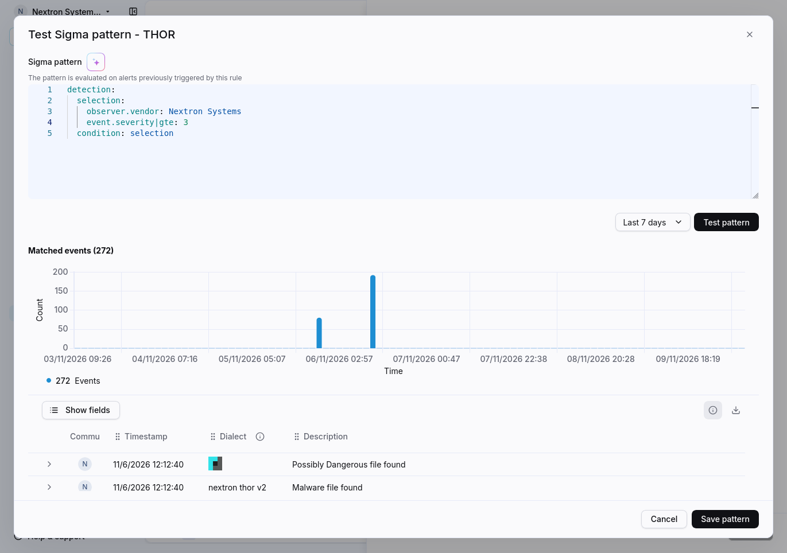
- **Start with Alert and Warning lines.** They are the findings. The `Info` and `Notice` lines describe the scan itself and are useful context during an investigation.
- **Group by scan.** Filter on `nextron.thor.scan_id` to see everything one scan reported, including what was scanned and how the scan ended.
- **Pivot on the observables.** File hashes, IP addresses, domains and user names are mapped to the standard taxonomy fields, so you can search for them across your other Sekoia sources.

## 8. Generating a THOR Cloud launcher (optional)

The integration also provides a playbook action, **Generate THOR Cloud launcher**. It returns a download link and a command that start a THOR Cloud scan on an endpoint. Use it in a playbook, for example to run a THOR scan on an asset as part of an incident response, and hand the command to whatever runs it on the endpoint, such as an EDR action.

The action uses the same account as the connector. It either uses an existing campaign or creates a new one. It needs two more permissions on the account API key (see [Create the API key](#11-create-the-api-key)):

| Permission | Section | Needed for |
|---|---|---|
| **Run Scans** | Access to all campaigns, or per campaign | Generating the launcher for a campaign. |
| **Create Campaigns** | Administrative | Creating a new campaign. |

A key with per-campaign permissions has no rights on campaigns created later. If the action creates campaigns, grant **Run Scans**, **List Scans** and **Read Logs** under **Access to all campaigns**. Otherwise the key can't generate a launcher for the new campaign, and the connector can't collect its scans.

To add the action to a playbook:

1. In the playbook editor, open **Actions**, search for `THOR Cloud` and drag **Generate THOR Cloud launcher** into the workflow.
2. On the **Account** tab, select the THOR Cloud account you connected in [Install the integration and connect your account](#21-install-the-integration-and-connect-your-account), and leave **Cloud** selected.

   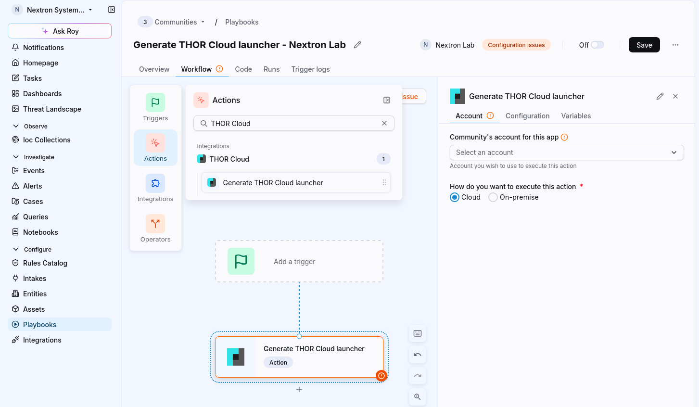

3. On the **Configuration** tab, fill in the settings described below. The form lists them in no particular order; use the search field to find one.

   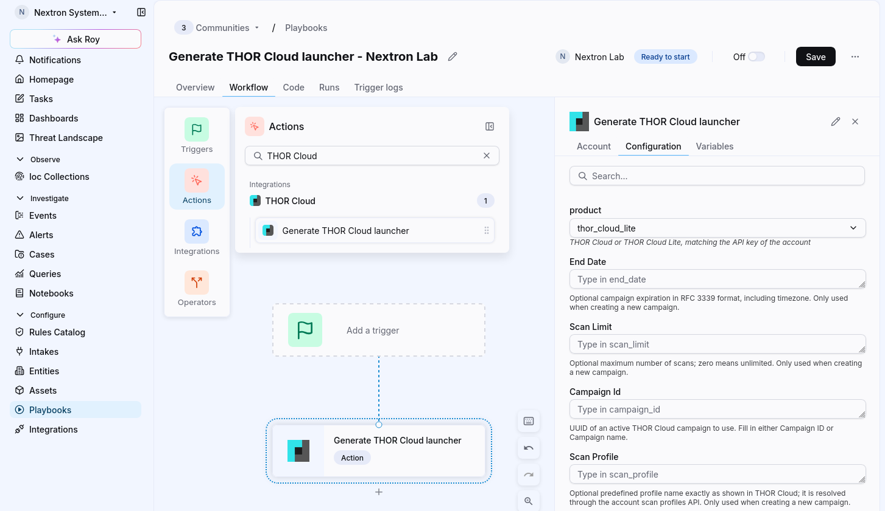

   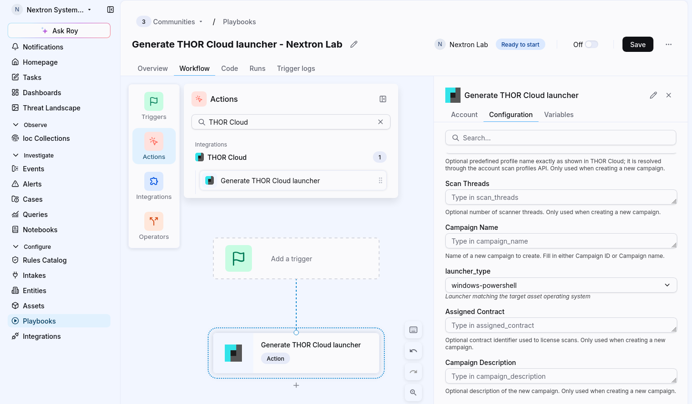

Fill in either **Campaign Id** to use an existing campaign, or **Campaign Name** to create a new one, not both. The other campaign settings only apply to new campaigns.

| Setting | Required | What it does |
|---|---|---|
| **Campaign Id** | one of the two | UUID of an existing campaign. The campaign must be active. |
| **Campaign Name** | one of the two | Name of the new campaign to create. |
| **Campaign Description** | no | Description of the new campaign. |
| **Assigned Contract** | no | The contract used to license the scans. |
| **End Date** | no | When the new campaign expires, in RFC 3339 format including the time zone, for example `2026-12-31T23:59:59+01:00`. |
| **Scan Profile** | no | A scan profile as named in THOR Cloud. Case doesn't matter. If the name is unknown, the action fails and lists the available profiles. |
| **Scan Limit** | no | Maximum number of scans in the new campaign. `0` means unlimited. |
| **Scan Threads** | no | Number of scanner threads. |
| **launcher_type** | yes | The operating system of the target endpoint: `windows-powershell`, `linux-bash` or `mac-bash`. |
| **product** | no | `thor_cloud` or `thor_cloud_lite`, matching the API key of the account. Default: `thor_cloud_lite`. |

The action returns:

| Field | Content |
|---|---|
| `campaign_id` / `campaign_name` | The campaign that was used or created. |
| `campaign_created` | `true` if the action created the campaign. |
| `launcher_type` / `filename` | The launcher type and a suggested file name. |
| `launcher_url` | The link to download the launcher. |
| `command` | A command that downloads and runs the launcher on the target operating system. |

> **Treat `launcher_url` and `command` as secrets.** They contain a token that lets anyone who has it start scans in your campaign. Don't write them into case comments, notifications or other places that are logged or shared.

Once the scan has finished, its results arrive through the intake like any other scan, as long as the connector can see the campaign: the API key needs **List Scans** and **Read Logs** on it, and the connector's **Campaigns** setting must be empty or contain the campaign.

## 9. Common questions

**No events arrive. What should I check?**
Open the **Connector logs** tab of the intake:

- An authentication error usually means that **Product** doesn't match your service, or that the API key is wrong, expired, or lacks the **List Scans** or **Read Logs** permission for the collected campaigns (see [Create the API key](#11-create-the-api-key)).
- `Found 0 scans` means that no scans were created within **Days Back**, or that **Campaigns** contains wrong UUIDs.
- `Found N scans (N new to forward)` without `events collected` means the scans are still running. They are collected once they finish.
- `has encrypted logs` means the campaign encrypts THOR logs. Turn off log encryption for the campaigns you want to collect.

**Will I get duplicates if I restart or reconfigure the intake?**
Not from a restart or a change of the settings. The connector remembers the scans it forwarded, also when you change **Days Back** (see [Choosing Days Back](#41-choosing-days-back)).

This memory belongs to the intake. If you delete the intake and create a new one, the new intake starts empty and collects every finished scan within **Days Back** again, including scans the old intake already sent. To keep the duplicates few, set **Days Back** of the new intake to `1`. Raising it later collects the older scans again as well.

**Can I collect from THOR Cloud and THOR Cloud Lite at the same time?**
Yes. Create one account per service and one intake per account, each with the matching **Product**.

**Can I collect several campaigns, but not all of them?**
Yes. Enter their UUIDs in **Campaigns**, separated by commas.

**Why do the events show a long delivery time?**
Events carry the time THOR logged them on the endpoint, but they're collected only after the whole scan has finished and the next poll has run (see [Checking the results](#5-checking-the-results)).

**Are scans with encrypted logs collected?**
No. The connector can't read encrypted logs and skips those scans.

**Are scans that failed collected?**
Yes, if they produced a JSON log. They contain the results up to the moment the scan failed.

**Does the integration start scans by itself?**
No. The connector only reads scan results. Scans are started in THOR Cloud or with the [launcher action](#8-generating-a-thor-cloud-launcher-optional).
