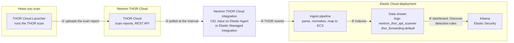
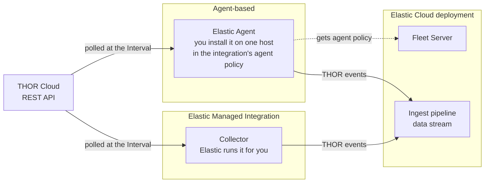
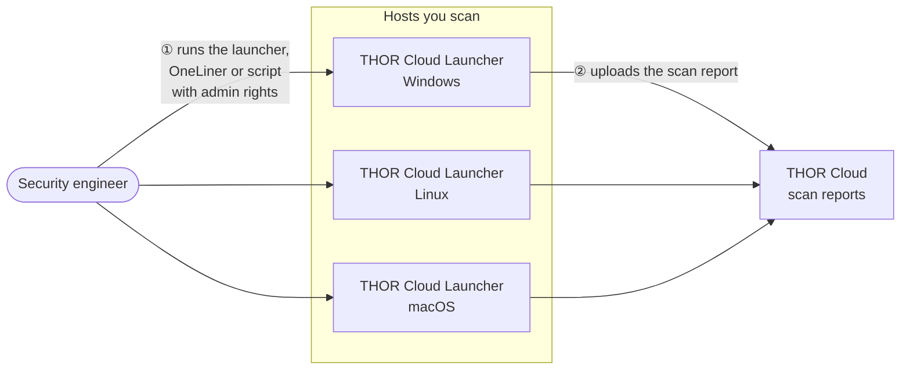
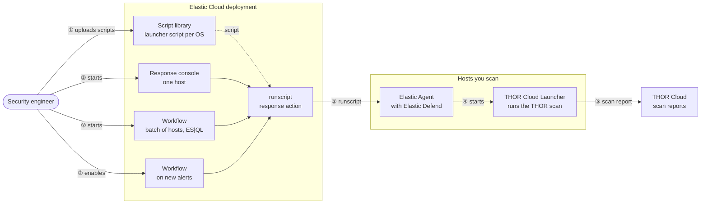

# Deploy Nextron THOR Cloud with Elastic Cloud

This guide explains how to deploy the THOR Cloud Launcher on your hosts and bring THOR scan results into Elastic Security on Elastic Cloud.

## Overview

THOR Cloud is Nextron Systems' on-demand compromise assessment service. A lightweight launcher deployed on Windows, Linux, and macOS endpoints executes the THOR forensic scanner, which applies over 30,000 pre-built signatures — YARA rules, Sigma rules, and IOCs — to detect attacker tools, intrusion traces, and post-exploitation activity that antivirus and EDR solutions typically miss.

The Nextron THOR Cloud integration collects scan results from the THOR Cloud REST API and ingests them into Elastic as ECS-normalized events, making compromise assessment findings available for threat hunting, detection, correlation, and incident response in Elastic Security. The integration ships with an overview dashboard and a Discover session for THOR findings.

## How it works

When a scan completes, the THOR scanner generates a scan report, and the THOR Cloud Launcher uploads it to THOR Cloud over HTTPS.

The Nextron THOR Cloud integration, running on Elastic Agent or as an Elastic Managed Integration, polls the THOR Cloud REST API over HTTPS at the configured **Interval** and retrieves the reports of finished scans. Each line of a report becomes one THOR event.

The ingest pipeline parses, normalizes, and enriches each THOR event. Selected fields are mapped to the Elastic Common Schema (ECS), and the events are indexed into a dedicated data stream, `logs-nextron_thor_apt_scanner.thor_forwarding-default`.

**Data flow**



### What you deploy

| Component | What it does | Where it runs |
|---|---|---|
| Nextron THOR Cloud integration | Collects the scan reports of all hosts from THOR Cloud | Once: on one Elastic Agent in its own agent policy (**Agent-based**), or as an **Elastic Managed Integration**. For large environments, choose Agent-based. |
| THOR Cloud Launcher | Runs the THOR scan | On every host you scan: deployed manually, or orchestrated via Elastic Defend |
| Elastic Defend (orchestrated deployment only) | Starts the launcher from Kibana | On every host you scan, as part of Elastic Agent |

You can deploy the launcher manually, or orchestrate it via Elastic Defend if the hosts you scan run, or will run, Elastic Agent with Elastic Defend. The following sections follow the deployment order: prepare THOR Cloud, deploy the integration, then deploy the launcher.

## Prerequisites

**THOR Cloud**

- A THOR Cloud account and a campaign.
- Customer-managed scan result encryption turned off.

**Elastic**

- An Elastic Cloud Hosted deployment at version 9.5 or later. The Elastic Agents you install must also be version 9.5 or later.
- For the orchestrated deployment: Elastic Agent with Elastic Defend on every host you scan (this guide shows how to add them), and a subscription that includes Elastic Defend response actions and Workflows.

**Network**

- The hosts you scan, and the Elastic Agent that runs the integration (Agent-based only), can reach `thor-cloud.nextron-services.com` over HTTPS (port 443).
- Every Elastic Agent can reach your Elastic Cloud deployment over HTTPS (port 443).

**Kibana privileges**

- **Fleet: All** and **Integrations: All**
- **Analytics → Discover: Read** and **Analytics → Dashboard: Read**
- For the orchestrated deployment, also:
  - **Elastic Defend Policy Management: All** and **Endpoint List: All**
  - **Elastic Defend Scripts Management: All**, **Execute Operations: All**, and **Response Actions History: All**
  - **Analytics → Workflows: All**
  - **Security → Alerts: Read**

## Prepare THOR Cloud

1. Log in to the THOR Cloud dashboard and go to **General Settings → API Key**.
2. Select **Generate**, then copy the key and store it securely: you can't view it again later. The API key has the same rights as your THOR Cloud user.

## Deploy the Nextron THOR Cloud integration

Deploy the integration once: a single copy collects the scan reports of all hosts. It runs on one Elastic Agent (**Agent-based**) or as an **Elastic Managed Integration**. Don't add it to the agent policy of the hosts you scan, because every agent in a policy runs all of the policy's integrations.

**Deployment**



1. In Kibana, find **Integrations** in the navigation menu or use the global search field. Search for **Nextron THOR Cloud**, and select **Add Nextron THOR Cloud**.
2. Under **Deployment options**, keep **Agent-based**, or select **Elastic Managed Integration**.
3. Keep **Collect Thor Cloud logs** turned on, and configure the settings:

   | Setting | Value |
   |---|---|
   | **Initial Interval** | `24h`: how far back the first run collects scan results |
   | **API url** | `https://thor-cloud.nextron-services.com/api` (pre-filled) |
   | **API Key** | The API key you generated in THOR Cloud |
   | **Interval** | `5m`: how often the integration polls THOR Cloud |

4. Complete the deployment.

   **Agent-based.** Under **Where to add this integration?**, choose one of the two tabs:

   - **New hosts**
     1. Enter a **New agent policy name**, for example `THOR Cloud`, and select **Save and continue**.
     2. Select **Add Elastic Agent to your hosts**, keep **Enroll in Fleet** selected, and choose the host's operating system.
     3. Run the commands on one host, as root or as Administrator. Use any server or VM that can reach THOR Cloud.
     4. In **Fleet → Agents**, wait until the agent is **Healthy**.
   - **Existing hosts**: Select an agent policy that contains only the Elastic Agent that should poll THOR Cloud, then select **Save and continue**.

   **Elastic Managed Integration.** Select **Save and continue**. Elastic runs the collector for you, so there is no Elastic Agent to install, and the integration doesn't appear under **Fleet → Agents**.

## Deploy the THOR Cloud Launcher

Deploy the launcher manually on each host, or orchestrate it from Kibana with Elastic Defend.

**Get the launcher.** In THOR Cloud, open your campaign and select **Launcher**. In **Choose one of the launcher options**, select the tab for the host's operating system: **Windows**, **Mac OS** (macOS), or **Linux**. Each tab offers the same kinds of options:

- **Launcher program**: on Windows, **THOR-Cloud-Launcher.exe** (Recommended)
- **OneLiner**: a command you copy and paste on the host
- **Launcher script**: **PowerShell Script** (`.ps1`) on Windows, a shell script (`.sh`) on macOS and Linux

The manual deployment uses any of the three. The orchestrated deployment uses the launcher script of each operating system you scan.

### Manual deployment

**Deployment**



1. On each host you scan, start the launcher with administrative rights (as Administrator on Windows, and as root on Linux and macOS). Use one of the launcher options:
   - **Launcher program**: download it to the host and run it.
   - **OneLiner**: paste it into a terminal with administrative rights on the host.
   - **Launcher script**: copy it to the host and run it.
2. Follow the scan in the THOR Cloud campaign view.

When the scan completes, the integration collects the scan report at its next poll.

### Orchestrated deployment via Elastic Defend

Elastic Defend runs the launcher script on the hosts you scan with the `runscript` response action. Elastic Defend runs as part of Elastic Agent, so every host you scan needs Elastic Agent.

**Deployment**



#### Add Elastic Defend to the hosts you scan

If Elastic Defend already runs on these hosts, continue with "Upload the launcher scripts".

1. Find **Integrations** in the navigation menu or use the global search field. Search for **Elastic Defend**, and select **Add Elastic Defend**.
2. Enter an **Integration name**, select **Traditional Endpoints**, and choose a preset.
3. Choose where to add it:
   - Hosts that already run Elastic Agent: on the **Existing hosts** tab, select their agent policy, then select **Save and continue**. Elastic Agent installs Elastic Defend.
   - Hosts without Elastic Agent: on the **New hosts** tab, enter a **New agent policy name** and select **Save and continue**. Select **Add Elastic Agent to your hosts**, keep **Enroll in Fleet** selected, and run the commands on each host, as root or as Administrator.
4. On macOS hosts, approve the Elastic Endpoint system extension and network content filtering. Then enable Full Disk Access for `ElasticEndpoint` and `co.elastic`, manually or with an MDM profile.

The hosts appear on the **Endpoints** page. If you also want to scan the host whose Elastic Agent runs the integration, add Elastic Defend to that agent's policy as well.

#### Upload the launcher scripts

1. Find **Script library** in the navigation menu or use the global search field.
2. Select **Upload script**, and configure:
   - **File**: the launcher script: **PowerShell Script** for Windows, the shell script for macOS and Linux
   - **File type**: **Script file**
   - **Name**: for example `THOR-Windows`, `THOR-Linux`, or `THOR-macOS`
   - **Operating systems**: the operating system of the script
3. Select **Upload**. Repeat for each operating system you scan.

The response console starts a script by its **Name**. The workflows use the script ID instead; step 1 of "Scan a batch of hosts" shows how to look it up.

#### Start scans

Use any of the three ways; they can be combined.

**Scan one host from the response console**

1. On the **Endpoints** page, open the host's **Actions** menu (**…**) and select **Respond**.
2. In the response console, run the script for the host's operating system:

   ```text
   runscript --script="THOR-Windows"
   ```

   The output confirms that the THOR Cloud Launcher started.

**Scan a batch of hosts**

1. Get the script IDs. Find **Dev Tools** in the navigation menu or use the global search field, and run the following request for each script:

   ```text
   GET kbn:/api/endpoint/scripts_library?kuery=name:"THOR-Windows"
   ```

   The script ID is the `id` value in the response.
2. Find **Workflows** in the navigation menu or use the global search field, create a workflow, and replace the editor content with the YAML below. Replace `<WINDOWS_SCRIPT_ID>`, `<LINUX_SCRIPT_ID>`, and `<MACOS_SCRIPT_ID>` with your script IDs, then select **Save**.
3. Select **Run** (▶). When Kibana asks for `esql_query`, provide the query that selects the hosts to scan, then select **Run**. The default query in the YAML selects all enrolled Elastic Defend endpoints. To narrow it, extend its first `WHERE` line, for example:
   - specific hosts: `AND host.name IN ("host-01", "host-02")`
   - one operating system: `AND host.os.name == "Windows"`

   Any ES|QL query works if it returns `agent.id` and `script_id`, in that order.

<details>
<summary>Workflow YAML: scan a batch of hosts</summary>

```yaml
name: THOR Cloud - Deploy Scan to Endpoints
description: Run the THOR Cloud launcher from the Script Library on Elastic Defend endpoints selected by ES|QL, using the script that matches each host's OS.

settings:
  timeout: "2h"

triggers:
  - type: manual
    inputs:
      - name: esql_query
        type: string
        description: ES|QL returning agent.id and script_id (Script Library ID per OS), in that order.
        required: true
        default: |
          FROM metrics-endpoint.metadata_current_*
          | WHERE Endpoint.status == "enrolled"
          | EVAL script_id = CASE(
              host.os.name == "Windows", "<WINDOWS_SCRIPT_ID>",
              host.os.name == "Linux",   "<LINUX_SCRIPT_ID>",
              host.os.name == "macOS",   "<MACOS_SCRIPT_ID>",
              null)
          | WHERE script_id IS NOT NULL
          | KEEP agent.id, script_id
          | LIMIT 2000

steps:
  # Columns consumed via foreach.item[N]: [0] agent.id  [1] script_id
  - name: get_target_endpoints
    type: elasticsearch.esql.query
    with:
      query: "{{ inputs.esql_query }}"

  # One run_script action per endpoint; a failed host does not stop the rollout.
  - name: deploy_thor
    type: foreach
    foreach: "{{ steps.get_target_endpoints.output.values }}"
    steps:
      - name: run_thor_script
        type: kibana.request
        with:
          method: POST
          path: /api/endpoint/action/run_script
          body:
            agent_type: endpoint
            endpoint_ids:
              - "{{ foreach.item[0] }}"
            parameters:
              scriptId: "{{ foreach.item[1] }}"
            comment: THOR Cloud deployment (workflow)
        on-failure:
          continue: true

  - name: log_summary
    type: console
    with:
      message: "THOR run_script processed for {{ steps.get_target_endpoints.output.values | size }} endpoint(s). See Response actions history for per-host status."
```

</details>

**Scan hosts with new alerts**

1. Create a second workflow with the YAML below.
2. Replace the three script IDs, select **Save**, and keep the workflow **Enabled**.

Every 5 minutes, the workflow finds new open high or critical alerts. It then starts a scan on each affected host, at most once per host every 24 hours (the `cooldown` value). A scheduled workflow runs with the privileges of the user who last saved it, so that user needs the privileges listed in Prerequisites.

<details>
<summary>Workflow YAML: scan hosts with new alerts</summary>

```yaml
name: THOR Cloud - Scan Endpoints with New Alerts
description: Every 5 minutes, find endpoints with new open high or critical Security alerts and run the OS-matching THOR Cloud launcher from the Script Library on each, at most once per host within the cooldown window.

consts:
  cooldown: now-24h

triggers:
  - type: scheduled
    with:
      every: 5m
  - type: manual

steps:
  # Endpoints with new alerts (10-minute window overlaps the 5-minute schedule; the cooldown prevents duplicates).
  # Columns consumed via foreach.item[N]: [0] agent.id  [1] script_id
  - name: get_alerting_endpoints
    type: elasticsearch.esql.query
    with:
      query: |
        FROM .alerts-security.alerts-*
        | WHERE @timestamp >= NOW() - 10 minutes
            AND kibana.alert.severity IN ("high", "critical")
            AND kibana.alert.workflow_status == "open"
            AND agent.id IS NOT NULL
        | STATS BY agent.id, host.os.type
        | EVAL script_id = CASE(
            host.os.type == "windows", "<WINDOWS_SCRIPT_ID>",
            host.os.type == "linux",   "<LINUX_SCRIPT_ID>",
            host.os.type == "macos",   "<MACOS_SCRIPT_ID>",
            null)
        | WHERE script_id IS NOT NULL
        | KEEP agent.id, script_id
        | LIMIT 1000

  - name: scan_endpoints
    type: foreach
    foreach: "{{ steps.get_alerting_endpoints.output.values }}"
    steps:
      # Skip hosts that already had a runscript action within the cooldown window.
      - name: check_recent_scan
        type: kibana.request
        with:
          method: GET
          path: /api/endpoint/action
          query:
            agentIds: "{{ foreach.item[0] }}"
            commands: runscript
            startDate: "{{ consts.cooldown }}"
            endDate: now
            pageSize: 1
        on-failure:
          continue: true

      - name: run_if_not_recent
        type: if
        condition: "steps.check_recent_scan.output.total : 0"
        steps:
          - name: run_thor_script
            type: kibana.request
            with:
              method: POST
              path: /api/endpoint/action/run_script
              body:
                agent_type: endpoint
                endpoint_ids:
                  - "{{ foreach.item[0] }}"
                parameters:
                  scriptId: "{{ foreach.item[1] }}"
                comment: THOR Cloud scan (triggered by Security alert)
            on-failure:
              continue: true
```

</details>

#### Follow the scans

- **Response actions history** (find it in the navigation menu or use the global search field): the status of each `runscript` action.
- The workflow's **Executions** tab: each workflow run.
- The THOR Cloud campaign view: the progress of each scan.

## Verify the results in Kibana

1. In **Discover**, select the `logs-*` data view, select a time range that includes the scan, and filter on:

   ```text
   data_stream.dataset : "nextron_thor_apt_scanner.thor_forwarding"
   ```

   Events appear at the integration's next poll after a scan completes.
2. Open the **[Logs Nextron Thor] Overview** dashboard and the **[Logs Nextron Thor] Findings** Discover session.

In THOR events, `host.name` is the scanned host.
