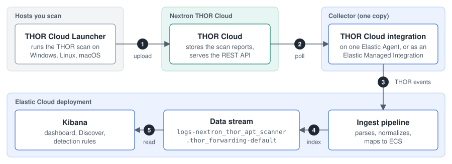

# Deploy Nextron THOR Cloud with Elastic Cloud

This guide explains how to deploy the THOR Cloud Launcher on your hosts and bring THOR scan results into Elastic Security on Elastic Cloud.


*The orchestrated deployment at a glance. The launcher also runs on Linux and macOS, and you can start it [manually](#manual-deployment) instead.*

> [!NOTE]
> The Nextron THOR Cloud integration is in technical preview (package version 0.7.0 at the time of writing). Field names can change between versions, so check the [changelog](https://github.com/elastic/integrations/blob/main/packages/nextron_thor/changelog.yml) before you upgrade.

| Resource | Link |
|---|---|
| Integration source code | [`elastic/integrations` → `packages/nextron_thor`](https://github.com/elastic/integrations/tree/main/packages/nextron_thor) |
| Integration reference: exported fields, sample event | [Nextron THOR Cloud in the Elastic docs](https://www.elastic.co/docs/reference/integrations/nextron_thor_apt_scanner) |
| THOR Cloud | [Product page](https://www.nextron-systems.com/thor-cloud/), [dashboard](https://thor-cloud.nextron-services.com/), [API documentation](https://thor-cloud.nextron-services.com/ui/api-documentation) (requires sign-in) |
| Elastic features used | [Elastic Managed integrations](https://www.elastic.co/docs/manage-data/ingest/managed-integrations/managed-integrations), [response actions](https://www.elastic.co/docs/solutions/security/endpoint-response-actions), [Script library](https://www.elastic.co/docs/solutions/security/endpoint-response-actions/script-library), [Workflows](https://www.elastic.co/docs/explore-analyze/workflows) |

The source folder is named `nextron_thor`, but the package name is `nextron_thor_apt_scanner`. The longer name is the one you see in the Elastic docs URL and in the data stream.

## Setup at a glance

1. Check the [prerequisites](#prerequisites).
2. [Generate an API key in THOR Cloud](#step-1-prepare-thor-cloud).
3. [Deploy the integration once](#step-2-deploy-the-nextron-thor-cloud-integration), on one Elastic Agent or as an Elastic Managed Integration.
4. [Run the launcher on the hosts you scan](#step-3-deploy-the-thor-cloud-launcher), manually or orchestrated via Elastic Defend.
5. [Verify the results in Kibana](#step-4-verify-the-results-in-kibana). If nothing arrives, go to [Troubleshooting](#troubleshooting).

The fastest way to first results is an Elastic Managed Integration and the launcher OneLiner on a single test host.

## Overview

THOR Cloud is Nextron Systems' on-demand compromise assessment service. A lightweight launcher deployed on Windows, Linux, and macOS endpoints executes the THOR forensic scanner, which applies over 30,000 pre-built signatures — YARA rules, Sigma rules, and IOCs — to detect attacker tools, intrusion traces, and post-exploitation activity that antivirus and EDR solutions typically miss.

The Nextron THOR Cloud integration collects scan results from the THOR Cloud REST API and ingests them into Elastic as ECS-normalized events, making compromise assessment findings available for threat hunting, detection, correlation, and incident response in Elastic Security. The integration ships with an overview dashboard and a Discover session for THOR findings.

## How it works



1. When a scan completes, the THOR Cloud Launcher uploads the scan report to THOR Cloud over HTTPS.
2. The integration polls the THOR Cloud REST API over HTTPS at the configured **Interval** and retrieves the reports of finished scans. The integration opens the connection, so THOR Cloud doesn't need to reach into your network.
3. Each line of a report becomes one THOR event, and the integration sends the events to Elastic.
4. The ingest pipeline parses, normalizes, and enriches each event, maps selected fields to the Elastic Common Schema (ECS), and indexes it into a dedicated data stream, `logs-nextron_thor_apt_scanner.thor_forwarding-default`.
5. Kibana reads the data stream for the dashboard, Discover, and detection rules.

### Which scans reach Elastic

The integration collects a scan only if all of these conditions are true. It skips any other scan without reporting an error.

| Condition | Details |
|---|---|
| The scan finished | The scan status is `successful` or `failed`. A running scan is collected once it finishes. |
| The report isn't encrypted | `logs_encrypted` is `false`. The integration can't read reports encrypted with a public key you provided in THOR Cloud. |
| The scan has a `thor.json` log | `thor.json` is listed in `available_logs`. It's the only log the integration reads. |
| The scan is in the collection window | Until the integration has collected its first scan, it looks back as far as **Initial Interval**. After that, it continues from the last scan it collected. |

To check these values for your scans, see [Check why a scan is missing](#check-why-a-scan-is-missing).

### What you deploy

| Component | What it does | Where it runs |
|---|---|---|
| Nextron THOR Cloud integration | Collects the scan reports of all hosts from THOR Cloud | Once: on one Elastic Agent in its own agent policy (**Agent-based**), or as an **Elastic Managed Integration** |
| THOR Cloud Launcher | Runs the THOR scan | On every host you scan: deployed manually, or orchestrated via Elastic Defend |
| Elastic Defend (orchestrated deployment only) | Starts the launcher from Kibana | On every host you scan, as part of Elastic Agent |

## Prerequisites

**THOR Cloud**

- A THOR Cloud or THOR Cloud Lite account with API access. THOR Cloud Lite uses a limited signature set and only some of the THOR modules, so expect fewer findings.
- A campaign. The settings are up to you: Nextron recommends the default, a full scan.
- No report encryption. THOR Cloud lets you provide a public key to encrypt reports, but the integration skips encrypted reports. Reports are only encrypted if you set this up.
- Elastic tested the integration with THOR scanner 10.7.x and the THOR JSON log format v2 (`log_version: v2.0.0`).

**Elastic**

- An Elastic Cloud Hosted deployment. Elastic Managed Integrations are also available on Elastic Cloud Serverless, and aren't available on self-managed deployments.
- Elastic Stack 9.5 or later is recommended, because everything in this guide is generally available from that version. The minimum depends on what you use:

  | What you use | Minimum version |
  |---|---|
  | Integration, Agent-based | 9.2 |
  | Integration, Elastic Managed Integration | 9.5 (technical preview in earlier versions) |
  | Orchestrated deployment: Script library, `runscript`, Workflows | 9.4 |

- Elastic Agent at the same version as your deployment. The enrollment commands in Kibana install the matching version.
- The integration works with a Basic subscription. The orchestrated deployment needs a [subscription](https://www.elastic.co/subscriptions/cloud) that includes Elastic Defend response actions and Workflows.
- For the orchestrated deployment: Elastic Agent with Elastic Defend on every host you scan. This guide shows how to add them.

**Network**

- The hosts you scan, and the Elastic Agent that runs the integration (Agent-based only), can reach `thor-cloud.nextron-services.com` over HTTPS (port 443). For THOR Cloud Lite, the host is `thorcloud-lite.nextron-services.com`. The launcher needs no other hosts.
- Every Elastic Agent can reach your Elastic Cloud deployment over HTTPS (port 443).

**Kibana privileges**

- **Fleet: All** and **Integrations: All**
- **Analytics → Discover: Read** and **Analytics → Dashboard: Read**
- For the orchestrated deployment, also:
  - **Elastic Defend Policy Management: All** and **Endpoint List: All**
  - **Elastic Defend Scripts Management: All**, **Execute Operations: All**, and **Response Actions History: All**
  - **Analytics → Workflows: All**
  - **Security → Alerts: Read**

**Elasticsearch index privileges**

- `read` and `view_index_metadata` on `logs-*`, to see the events in Discover and on the dashboard.
- For the workflows: `read` on `metrics-endpoint.metadata_current_*` and `.alerts-security.alerts-*`, which their ES|QL queries read.

## Step 1: Prepare THOR Cloud

1. Log in to the [THOR Cloud dashboard](https://thor-cloud.nextron-services.com/) and go to **General Settings → API Key**.
2. Select **Generate**, then copy the key and store it securely: you can't view it again later. The API key has the same rights as your THOR Cloud user.
3. Note your **API Endpoint URL**. The default is `https://thor-cloud.nextron-services.com/api`.

To test the key, run the [API check](#check-why-a-scan-is-missing) from Troubleshooting.

## Step 2: Deploy the Nextron THOR Cloud integration

Deploy the integration once: a single copy collects the scan reports of all hosts.


| | Agent-based | Elastic Managed Integration |
|---|---|---|
| **What you run** | One Elastic Agent on a server or VM | Nothing: Elastic runs the collector |
| **Throughput** | Depends on your host | Limited to [300 events per second](https://www.elastic.co/docs/manage-data/ingest/managed-integrations/managed-integrations-faq), without horizontal scaling. Above the limit, ingestion is throttled and delayed. |
| **Outbound traffic** | Comes from your host, optionally through a proxy | Comes from Elastic's shared infrastructure, with no fixed IP addresses, so you can't use IP restrictions on the API key |
| **Cost** | Your host | [Charged per integration-hour](https://www.elastic.co/docs/manage-data/ingest/managed-integrations/managed-integrations-faq) on Elastic Cloud Hosted |
| **Choose it when** | You have a large environment, or need a proxy or a known source IP | You want the quickest setup in a smaller environment |

> [!WARNING]
> Don't add the integration to the agent policy of the hosts you scan. Every agent in a policy runs all of the policy's integrations, so every one of those hosts would poll THOR Cloud.

1. In Kibana, find **Integrations** in the navigation menu or use the global search field. Search for **Nextron THOR Cloud**, and select **Add Nextron THOR Cloud**.
2. Under **Deployment options**, keep **Agent-based**, or select **Elastic Managed Integration**.
3. Keep **Collect Thor Cloud logs** turned on, and configure the settings:

   | Setting | Value |
   |---|---|
   | **Initial Interval** | `24h`: how far back the integration looks until it has collected its first scan. Use `h`, `m`, or `s` as the unit: for 30 days, enter `720h`. |
   | **API url** | The API Endpoint URL from THOR Cloud. Pre-filled with `https://thor-cloud.nextron-services.com/api`. For THOR Cloud Lite, use `https://thorcloud-lite.nextron-services.com/api`. |
   | **API Key** | The API key you generated in THOR Cloud |
   | **Interval** | `5m`: how often the integration polls THOR Cloud |

   If you need them, the advanced options include **Proxy URL**, **SSL Configuration**, and **HTTP Client Timeout** (default `30s`).

4. Complete the deployment.

   **Agent-based.** Under **Where to add this integration?**, choose one of the two tabs:

   - **New hosts**
     1. Enter a **New agent policy name**, for example `THOR Cloud`, and select **Save and continue**.
     2. Select **Add Elastic Agent to your hosts**, keep **Enroll in Fleet** selected, and choose the host's operating system.
     3. Run the commands on one host, as root or as Administrator. Use any server or VM that can reach THOR Cloud.
     4. In **Fleet → Agents**, wait until the agent is **Healthy**.
   - **Existing hosts**: Select an agent policy that contains only the Elastic Agent that should poll THOR Cloud, then select **Save and continue**.

   **Elastic Managed Integration.** Select **Save and continue**. Elastic runs the collector for you, so there is no Elastic Agent to install, and the integration doesn't appear under **Fleet → Agents**. Its status is on the integration's **Integration policies** tab.

## Step 3: Deploy the THOR Cloud Launcher

Deploy the launcher [manually](#manual-deployment) on each host, or [orchestrate it from Kibana](#orchestrated-deployment-via-elastic-defend) if the hosts you scan run, or will run, Elastic Agent with Elastic Defend.

**Get the launcher.** In THOR Cloud, open your campaign and select **Launcher**. In **Choose one of the launcher options**, select the tab for the host's operating system: **Windows**, **Mac OS** (macOS), or **Linux**. Each tab offers the same kinds of options:

- **Launcher program**: on Windows, **THOR-Cloud-Launcher.exe** (Recommended)
- **OneLiner**: a command you copy and paste on the host
- **Launcher script**: **PowerShell Script** (`.ps1`) on Windows, a shell script (`.sh`) on macOS and Linux

The manual deployment uses any of the three. The orchestrated deployment uses the launcher script of each operating system you scan.

### Manual deployment

1. On each host you scan, start the launcher with administrative rights (as Administrator on Windows, and as root on Linux and macOS). Use one of the launcher options:
   - **Launcher program**: download it to the host and run it.
   - **OneLiner**: paste it into a terminal with administrative rights on the host.
   - **Launcher script**: copy it to the host and run it.
2. Follow the scan in the THOR Cloud campaign view.

When the scan completes, the integration collects the scan report at its next poll.

### Orchestrated deployment via Elastic Defend

Elastic Defend runs the launcher script on the hosts you scan with the `runscript` response action. Elastic Defend runs as part of Elastic Agent, so every host you scan needs Elastic Agent.


1. You [upload the launcher scripts](#upload-the-launcher-scripts) to the Script library.
2. You [start a scan](#start-scans) from the response console or a batch workflow, or let the alert workflow start one.
3. Kibana sends the `runscript` response action to the host.
4. Elastic Agent with Elastic Defend starts the launcher, which runs the THOR scan.
5. The launcher uploads the scan report to THOR Cloud.

#### Add Elastic Defend to the hosts you scan

If Elastic Defend already runs on these hosts, continue with [Upload the launcher scripts](#upload-the-launcher-scripts).

1. Find **Integrations** in the navigation menu or use the global search field. Search for **Elastic Defend**, and select **Add Elastic Defend**.
2. Enter an **Integration name**, select **Traditional Endpoints**, and choose a preset.
3. Choose where to add it:
   - Hosts that already run Elastic Agent: on the **Existing hosts** tab, select their agent policy, then select **Save and continue**. Elastic Agent installs Elastic Defend.
   - Hosts without Elastic Agent: on the **New hosts** tab, enter a **New agent policy name** and select **Save and continue**. Select **Add Elastic Agent to your hosts**, keep **Enroll in Fleet** selected, and run the commands on each host, as root or as Administrator.
4. On macOS hosts, approve the Elastic Endpoint system extension and network content filtering. Then enable Full Disk Access for `ElasticEndpoint` and `co.elastic`, manually or with an MDM profile.

The hosts appear on the **Endpoints** page. If you also want to scan the host whose Elastic Agent runs the integration, add Elastic Defend to that agent's policy as well.

#### Upload the launcher scripts

1. Find **Script library** in the navigation menu or use the global search field.
2. Select **Upload script**, and configure:
   - **File**: the launcher script: **PowerShell Script** for Windows, the shell script for macOS and Linux
   - **File type**: **Script file**
   - **Name**: for example `THOR-Windows`, `THOR-Linux`, or `THOR-macOS`
   - **Operating systems**: the operating system of the script
3. Select **Upload**. Repeat for each operating system you scan.

The Script library rejects a file with the same SHA-256 hash as an existing script. If two of your launcher scripts are identical, upload the file once, select both operating systems, and use its script ID for both in the workflows.

The response console starts a script by its **Name**. The workflows use the script ID instead: [Scan a batch of hosts](#scan-a-batch-of-hosts) shows how to look it up.

#### Start scans

Use any of the three ways; they can be combined. Scans count towards any scan limit of your THOR Cloud plan.

##### Scan one host from the response console

1. On the **Endpoints** page, open the host's **Actions** menu (**…**) and select **Respond**.
2. In the response console, run the script for the host's operating system:

   ```text
   runscript --script="THOR-Windows"
   ```

   The output confirms that the THOR Cloud Launcher started. The host waits up to four hours for the script to complete. To change this, add `--timeout`, for example `--timeout=8h`.

##### Scan a batch of hosts

1. Get the script IDs. Find **Dev Tools** in the navigation menu or use the global search field, and run the following request for each script:

   ```text
   GET kbn:/api/endpoint/scripts_library?kuery=name:"THOR-Windows"
   ```

   The script ID is the `id` value in the response.
2. Find **Workflows** in the navigation menu or use the global search field, create a workflow, and replace the editor content with the YAML below. Replace `<WINDOWS_SCRIPT_ID>`, `<LINUX_SCRIPT_ID>`, and `<MACOS_SCRIPT_ID>` with your script IDs, and delete the `CASE` line of any operating system you don't scan. Then select **Save**.
3. Select **Run** (▶). When Kibana asks for `esql_query`, provide the query that selects the hosts to scan, then select **Run**. To narrow the default query, extend its first `WHERE` line, for example:
   - specific hosts: `AND host.name IN ("host-01", "host-02")`
   - one operating system: `AND host.os.name == "Windows"`

   Any ES|QL query works if it returns `agent.id` and `script_id`, in that order.

> [!WARNING]
> The default query selects all enrolled Elastic Defend endpoints, up to 2,000, and starts a scan on each of them. For your first run, narrow it to one test host.

<details>
<summary>Workflow YAML: scan a batch of hosts</summary>

```yaml
name: THOR Cloud - Deploy Scan to Endpoints
description: Run the THOR Cloud launcher from the Script Library on Elastic Defend endpoints selected by ES|QL, using the script that matches each host's OS.

settings:
  timeout: "2h"

inputs:
  - name: esql_query
    type: string
    description: ES|QL returning agent.id and script_id (Script Library ID per OS), in that order.
    required: true
    default: |
      FROM metrics-endpoint.metadata_current_*
      | WHERE Endpoint.status == "enrolled"
      | EVAL script_id = CASE(
          host.os.name == "Windows", "<WINDOWS_SCRIPT_ID>",
          host.os.name == "Linux",   "<LINUX_SCRIPT_ID>",
          host.os.name == "macOS",   "<MACOS_SCRIPT_ID>",
          null)
      | WHERE script_id IS NOT NULL
      | KEEP agent.id, script_id
      | LIMIT 2000

triggers:
  - type: manual

steps:
  # Columns consumed via foreach.item[N]: [0] agent.id  [1] script_id
  - name: get_target_endpoints
    type: elasticsearch.esql.query
    with:
      query: "{{ inputs.esql_query }}"

  # One run_script action per endpoint; a failed host does not stop the rollout.
  - name: deploy_thor
    type: foreach
    foreach: "{{ steps.get_target_endpoints.output.values }}"
    steps:
      - name: run_thor_script
        type: kibana.request
        with:
          method: POST
          path: /api/endpoint/action/run_script
          body:
            agent_type: endpoint
            endpoint_ids:
              - "{{ foreach.item[0] }}"
            parameters:
              scriptId: "{{ foreach.item[1] }}"
            comment: THOR Cloud deployment (workflow)
        on-failure:
          continue: true

  - name: log_summary
    type: console
    with:
      message: "THOR run_script processed for {{ steps.get_target_endpoints.output.values | size }} endpoint(s). See Response actions history for per-host status."
```

</details>

##### Scan hosts with new alerts

1. Create a second workflow with the YAML below.
2. Replace the three script IDs, delete the `CASE` line of any operating system you don't scan, select **Save**, and keep the workflow **Enabled**.

Every 5 minutes, the workflow finds new open high or critical alerts. It then starts a scan on each affected host, at most once per host every 24 hours (the `cooldown` value). A scheduled workflow runs with the privileges of the user who last saved it, so that user needs the privileges listed in [Prerequisites](#prerequisites).

Before you enable it, consider how it behaves:

- The cooldown counts every `runscript` action on the host, not only THOR scans. Any other script run on the host delays the next scan.
- If a THOR scan itself raises a high or critical alert on the host, the workflow starts a new scan each time the cooldown ends. If you see this, add an exception in Elastic Security.
- Alerts created from THOR events don't start a scan, because THOR events have no `host.os.type` value.

<details>
<summary>Workflow YAML: scan hosts with new alerts</summary>

```yaml
name: THOR Cloud - Scan Endpoints with New Alerts
description: Every 5 minutes, find endpoints with new open high or critical Security alerts and run the OS-matching THOR Cloud launcher from the Script Library on each, at most once per host within the cooldown window.

consts:
  cooldown: now-24h

triggers:
  - type: scheduled
    with:
      every: 5m
  - type: manual

steps:
  # Endpoints with new alerts (10-minute window overlaps the 5-minute schedule; the cooldown prevents duplicates).
  # Columns consumed via foreach.item[N]: [0] agent.id  [1] script_id
  - name: get_alerting_endpoints
    type: elasticsearch.esql.query
    with:
      query: |
        FROM .alerts-security.alerts-*
        | WHERE @timestamp >= NOW() - 10 minutes
            AND kibana.alert.severity IN ("high", "critical")
            AND kibana.alert.workflow_status == "open"
            AND agent.id IS NOT NULL
        | STATS BY agent.id, host.os.type
        | EVAL script_id = CASE(
            host.os.type == "windows", "<WINDOWS_SCRIPT_ID>",
            host.os.type == "linux",   "<LINUX_SCRIPT_ID>",
            host.os.type == "macos",   "<MACOS_SCRIPT_ID>",
            null)
        | WHERE script_id IS NOT NULL
        | KEEP agent.id, script_id
        | LIMIT 1000

  - name: scan_endpoints
    type: foreach
    foreach: "{{ steps.get_alerting_endpoints.output.values }}"
    steps:
      # Skip hosts that already had a runscript action within the cooldown window.
      - name: check_recent_scan
        type: kibana.request
        with:
          method: GET
          path: /api/endpoint/action
          query:
            agentIds: "{{ foreach.item[0] }}"
            commands: runscript
            startDate: "{{ consts.cooldown }}"
            endDate: now
            pageSize: 1
        on-failure:
          continue: true

      - name: run_if_not_recent
        type: if
        condition: "steps.check_recent_scan.output.total : 0"
        steps:
          - name: run_thor_script
            type: kibana.request
            with:
              method: POST
              path: /api/endpoint/action/run_script
              body:
                agent_type: endpoint
                endpoint_ids:
                  - "{{ foreach.item[0] }}"
                parameters:
                  scriptId: "{{ foreach.item[1] }}"
                comment: THOR Cloud scan (triggered by Security alert)
            on-failure:
              continue: true
```

</details>

#### Follow the scans

- **Response actions history** (find it in the navigation menu or use the global search field): the status of each `runscript` action.
- The workflow's **Executions** tab: each workflow run.
- The THOR Cloud campaign view: the progress of each scan.

## Step 4: Verify the results in Kibana

1. In **Discover**, select the `logs-*` data view, select a time range that includes the scan, and filter on:

   ```text
   data_stream.dataset : "nextron_thor_apt_scanner.thor_forwarding"
   ```

   Events appear at the integration's next poll after a scan completes. If none appear, go to [Troubleshooting](#troubleshooting).
2. Open the **[Logs Nextron Thor] Overview** dashboard and the **[Logs Nextron Thor] Findings** Discover session.

<a href="https://raw.githubusercontent.com/elastic/integrations/main/packages/nextron_thor/img/nextron_thor_apt_scanner-thor_forwarding-overview-dashboard.png"></a>

### Read the events

| Field | Contents |
|---|---|
| `host.name` | The scanned host |
| `agent.name`, `agent.id` | The collector that polled THOR Cloud, not the scanned host |
| `log.level` | The THOR level, such as `Alert`, `Warning`, or `Notice` |
| `event.kind` | `alert` for `Alert`-level events |
| `event.module` | The THOR module that produced the event, such as `Filescan` |
| `rule.name`, `thor.reasons.name` | The signature that matched |
| `thor.scan_id`, `thor.campaign_id` | The THOR Cloud scan and campaign |

To see only findings, filter on `log.level : ("Alert" or "Warning" or "Notice")`.

### Create alerts from findings

The integration indexes events and doesn't create Security alerts. To get alerts, create a custom query detection rule on the index pattern `logs-nextron_thor_apt_scanner.thor_forwarding-*`, for example with the query `event.kind : "alert"`.

## Troubleshooting

### No events appear in Kibana

Work through these checks in order:

1. **Look for collection errors.** In Discover, filter on:

   ```text
   data_stream.dataset : "nextron_thor_apt_scanner.thor_forwarding" and error.message : *
   ```

   The integration reports API errors as events. `error.message` names the failed request, and `error.code` holds the HTTP status.
2. **Check the collector.** For **Agent-based**, the agent must be **Healthy** in **Fleet → Agents**. For **Elastic Managed Integration**, check the status on the integration's **Integration policies** tab, and hover over it to see the reason.
3. **Check the scan.** See [Check why a scan is missing](#check-why-a-scan-is-missing).

| Symptom | Likely cause | Fix |
|---|---|---|
| `error.code` is `401`, or the message says `unauthenticated request` | The API key is wrong or no longer valid, or its IP restrictions exclude the collector | Generate a new key in THOR Cloud and update the integration, or change the key's IP restrictions |
| Requests time out or can't connect (Agent-based) | The agent's host can't reach THOR Cloud | Allow the [network access](#prerequisites), or set **Proxy URL** in the advanced options |
| Timeouts on `/v1/scan/log` | A large report takes longer than **HTTP Client Timeout** to download | Increase **HTTP Client Timeout** in the advanced options |
| No errors, and a scan is missing | The scan doesn't meet the [conditions](#which-scans-reach-elastic) | Run the [API check](#check-why-a-scan-is-missing) |
| Older scans are missing | They finished before the first collection window | See [Collect older scans](#collect-older-scans) |

### Check why a scan is missing

Run this check from a Linux or macOS host that can reach THOR Cloud. It calls the same API endpoint as the integration, so it also tests your API key and the network path. It requires `curl` and `jq`. For THOR Cloud Lite, change the host name.

```bash
read -rs THOR_CLOUD_API_KEY
curl -sS -G "https://thor-cloud.nextron-services.com/api/v1/scan/search" \
  -H "Authorization: $THOR_CLOUD_API_KEY" \
  --data-urlencode "limit=10" \
  --data-urlencode "order_field=last_launcher_update" \
  --data-urlencode "order_dir=DESC" \
  | jq '.message // (.data[] | {id, status, logs_encrypted, available_logs, last_launcher_update})'
```

Paste the API key after the first command and press Enter. The output lists your 10 most recent scans. Compare each with the [conditions](#which-scans-reach-elastic). `last_launcher_update` is in Unix time.

### Collect older scans

**Initial Interval** only applies until the integration has collected its first scan, so raising it later has no effect. To collect older scans afterwards, add a new copy of the integration with a larger **Initial Interval**, and remove the old copy. Events from scans in the new window may be collected again.

### Orchestrated deployment

| Symptom | Likely cause | Fix |
|---|---|---|
| **Script library** or **Workflows** isn't in the navigation menu | The version, subscription, or privileges don't allow it | Check the [prerequisites](#prerequisites). For **Workflows**, also check that `workflows:ui:enabled` is turned on in **Advanced Settings**. |
| The script upload is rejected | A script with the same SHA-256 hash already exists | Add the operating system to the existing script |
| `runscript` doesn't offer your script | The script's **Operating systems** doesn't include the host's | Edit the script in the **Script library** |
| A workflow run does nothing | The query returned no rows | On the **Executions** tab, open the `get_target_endpoints` or `get_alerting_endpoints` step and check its output |
| `runscript` actions fail in a workflow | A script ID is wrong or still has a placeholder | Check the script IDs in the `CASE` lines |
| A workflow's query fails with a privileges error | The user lacks [index privileges](#prerequisites) | Grant them. For a scheduled workflow, the user who last saved it needs them, and must save it again to refresh its access. |
